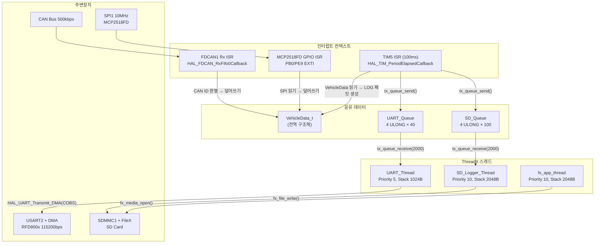
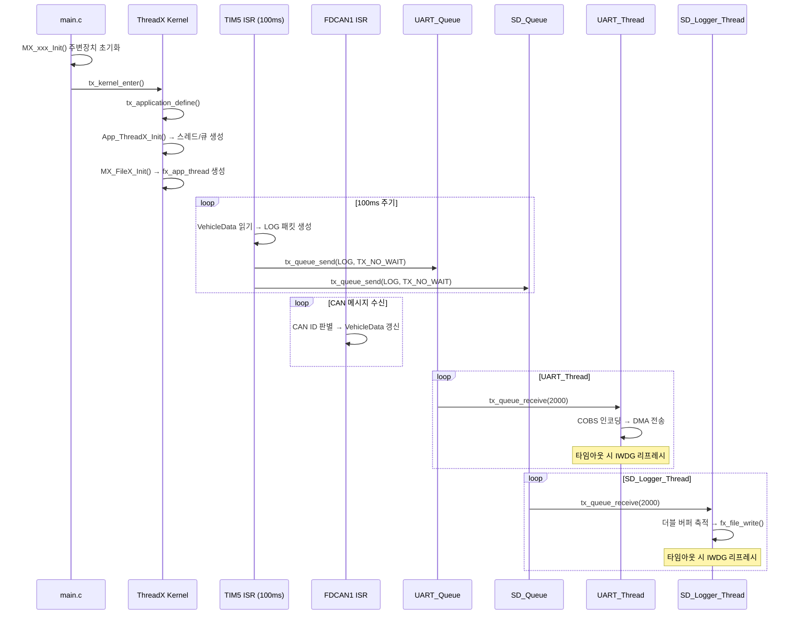
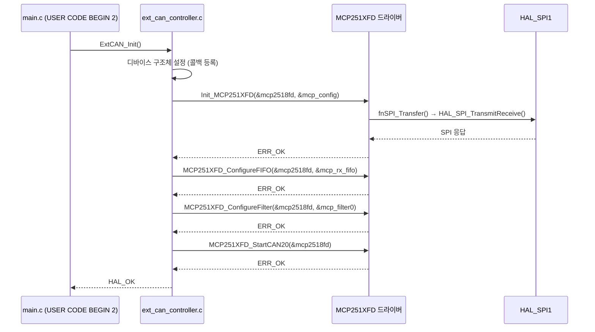
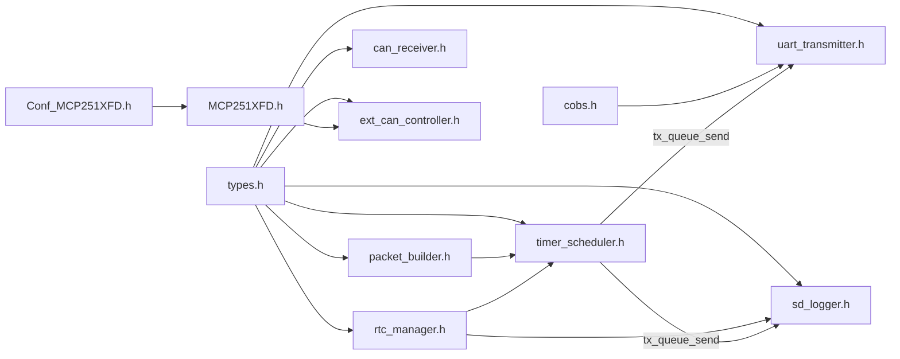

# 설계 문서: WSC 텔레메트리 펌웨어

## 개요

본 설계 문서는 WSC(World Solar Challenge) 태양광 자동차 텔레메트리 보드 펌웨어의 기술 설계를 정의한다. STM32U575xx(Cortex-M33, 160MHz) MCU 위에서 ThreadX(Azure RTOS)를 기반으로 동작하며, 차량 CAN 버스 데이터를 수집하여 16바이트 LOG 패킷으로 포장한 후 RFD900x(UART)로 무선 전송하고 SD 카드에 백업 로깅하는 완전한 비동기 Producer-Consumer 시스템이다.

### 핵심 설계 원칙

- **ThreadX 기반 비동기 아키텍처**: while(1) 폴링 대신 `tx_queue_receive(2000)` 유한 타임아웃 대기 (워치독 안전)
- **Producer-Consumer 모델**: TIM5 ISR(Producer) → ThreadX Message Queue → UART/SD 스레드(Consumer)
- **CubeMX 호환성**: 모든 커스텀 코드는 `/* USER CODE BEGIN/END */` 블록 내부에만 작성
- **오류 격리**: LED는 오류 표시기로만 사용, 각 모듈 독립적 오류 처리

### 요구사항 문서 대비 ThreadX 전환 사항

요구사항 문서의 일부 "메인 루프(while(1))" 표현은 다음과 같이 ThreadX 구조로 전환된다:

| 요구사항 표현 | 실제 설계 |
|---|---|
| 요구사항 8: "메인 루프에서 Ring_Buffer 확인" | UART_Thread: `tx_queue_receive(2000)` 유한 타임아웃 |
| 요구사항 9: "메인 루프에서 SD 버퍼 확인" | SD_Logger_Thread: `tx_queue_receive(2000)` 유한 타임아웃 |
| 요구사항 10: "메인 루프 폴링" | ThreadX 스레드 블로킹 대기 |
| 요구사항 6: "Ring_Buffer Enqueue" | `tx_queue_send()` to UART_Queue & SD_Queue |
| 요구사항 7: Ring_Buffer | ThreadX Message Queue (UART_Queue, SD_Queue) |

## 아키텍처

### 시스템 아키텍처 다이어그램



### 실행 흐름



### ThreadX 리소스 할당

| 리소스 | 이름 | 설정 | 메모리 풀 |
|---|---|---|---|
| Thread | UART_Thread | Priority 5, Stack 1024B, Auto Start | tx_app_byte_pool (16KB) |
| Thread | UART_RX_Thread | Priority 7, Stack 1024B, Auto Start | tx_app_byte_pool (16KB) |
| Thread | SD_Logger_Thread | Priority 10, Stack 2048B, Auto Start | tx_app_byte_pool (16KB) |
| Thread | MCP_RX_Thread | Priority 6, Stack 1024B, Auto Start | tx_app_byte_pool (16KB) |
| Thread | fx_app_thread | Priority 10, Stack 2048B, Auto Start | fx_byte_pool (16KB) |
| Queue | UART_Queue | Msg 4 ULONG (16B), Depth 40 | tx_app_byte_pool |
| Queue | SD_Queue | Msg 4 ULONG (16B), Depth 100 | tx_app_byte_pool |
| Semaphore | sd_tx_semaphore | FileX SD DMA TX 동기화 | CubeMX 자동 생성 |
| Semaphore | sd_rx_semaphore | FileX SD DMA RX 동기화 | CubeMX 자동 생성 |
| Semaphore | uart_tx_complete_sem | UART DMA 전송 완료 동기화 | tx_app_byte_pool |
| Semaphore | mcp_rx_semaphore | MCP2518FD 수신 통지 (EXTI → MCP_RX_Thread), count 0 | tx_app_byte_pool |

**메모리 예산 (tx_app_byte_pool 16KB)**:
- UART_Thread 스택: 1024B
- UART_RX_Thread 스택: 1024B
- SD_Logger_Thread 스택: 2048B
- MCP_RX_Thread 스택: 1024B
- uart_tx_complete_sem / mcp_rx_semaphore / mcp_spi_mutex: 각 ~80~100B
- **합계**: ~5.4KB / 16KB (여유 ~10.6KB)

> ⚠ **정정 (2026-07-31 2차 점검)**: 이전 판에는 UART_Queue/SD_Queue 스토리지가 이 목록에 들어
> 있었으나 **사실이 아니다**. 두 큐의 스토리지는 `app_threadx.c`의 `static ULONG uart_queue_storage[]`
> / `sd_queue_storage[]`, 즉 **BSS 정적 배열**이며 byte pool을 쓰지 않는다(`tx_queue_create`에
> 그 주소를 넘길 뿐이다). 마찬가지로 `fx_sd_media_memory`(512B)·`fx_fault_tolerant_buffer`(4096B)도
> BSS다. byte pool에서 실제로 할당되는 것은 **스레드 스택뿐**이다.

**큐 스토리지 (BSS, byte pool 아님)**:
- UART_Queue: 16B × 40 = 640B   (2026-07: 32B×20 → 16B×40, 총량 동일·깊이 2배)
- SD_Queue: 16B × 100 = 1600B   (2026-07: 32B×50 → 16B×100, 총량 동일·깊이 2배)

> **여유**: 전체 RAM 사용량은 768KB 중 약 7%(PHASE4 활성 빌드 기준 55.7KB)에 불과하다. 향후 큐
> 깊이를 더 키워야 하면 **RAM은 사실상 제약이 아니다** — 위 두 정적 배열의 depth 상수만 올리면 된다.

### 인터럽트 우선순위 설계

PriorityGroup은 `NVIC_PRIORITYGROUP_4`(4비트 전부 preemption, sub-priority 미사용). 숫자가 작을수록 시급하며, 짧고 시급한 인터럽트가 길고 느린 인터럽트를 선점하도록 배치한다.

| 인터럽트 | Preemption Priority | 비고 |
|---|---|---|
| FDCAN1_IT0/IT1 | 1 | 네이티브 CAN 수신 (짧음, 최우선) |
| TIM5 | 1 | 100ms 스케줄러 + IWDG 갱신 (밀리면 안 됨) |
| EXTI0/EXTI9 | 2 | MCP2518FD INT (CAN_INT/CAN_RX_INT, falling) |
| SPI1 | 2 | MCP2518FD 통신 (SPI-to-CAN과 동일 등급) |
| USART2 | 2 | UART DMA 완료 |
| SDMMC1 | 2 | SD DMA 완료 |
| GPDMA1_Ch1/Ch2 | 3 | UART RX/TX DMA |
| SysTick | 14 | ThreadX 커널 틱 (CubeMX 기본값) |
| TIM6 (HAL Timebase) | 15 | HAL_GetTick() ms 카운터 (기본값, 최하위) |

> **주의 (HAL timeout-in-ISR) — 해결됨**: TIM6(HAL tick)이 최하위(15)이므로, 더 높은 우선순위 ISR(예: EXTI=2) 안에서 블로킹 HAL 함수(`HAL_SPI_TransmitReceive(..., 10ms)`)를 호출하면 그동안 `HAL_GetTick()`이 멈춰 timeout이 만료되지 않는 함정이 있다. **본 설계는 MCP 수신을 deferred 구조(EXTI→`mcp_rx_semaphore`→`MCP_RX_Thread`)로 처리**하여, 블로킹 SPI를 스레드 컨텍스트에서 수행한다(요구사항 9.7 충족). 아래 "인터럽트 처리 흐름" 참조.

## 컴포넌트 및 인터페이스

### 모듈 구조

```
Core/Inc/
├── types.h              # 모든 타입 정의 (VehicleData_t, LOG, DATETIME, 열거형)
├── packet_builder.h     # LOG 패킷 생성 인터페이스
├── cobs.h               # COBS 인코딩/디코딩 인터페이스
├── can_receiver.h       # FDCAN1 수신 콜백 인터페이스
├── ext_can_controller.h # MCP2518FD SPI 제어 인터페이스 (Emandhal/MCP251XFD 래퍼)
├── Conf_MCP251XFD.h     # MCP251XFD 드라이버 설정 템플릿 (SPI 버퍼 크기 등)
├── uart_transmitter.h   # UART_Thread 인터페이스
├── sd_logger.h          # SD_Logger_Thread 인터페이스
├── rtc_manager.h        # RTC 시각 관리 인터페이스
└── timer_scheduler.h    # TIM5 ISR 스케줄러 인터페이스

Core/Src/
├── packet_builder.c
├── cobs.c
├── can_receiver.c
├── ext_can_controller.c # MCP251XFD 드라이버 콜백 구현 + 초기화/수신 로직
├── uart_transmitter.c
├── sd_logger.c
├── rtc_manager.c
└── timer_scheduler.c

Lib/MCP251XFD/            # Emandhal/MCP251XFD 외부 드라이버 라이브러리
├── MCP251XFD.h           # 드라이버 코어 헤더 (구조체, 함수 선언)
├── MCP251XFD.c           # 드라이버 코어 구현
└── ErrorsDef.h           # 에러 코드 정의 (ERR_OK, ERR_xxx 등)
```

> **참고**: `Lib/MCP251XFD`/ 디렉토리는 [Emandhal/MCP251XFD](https://github.com`Emandhal`MCP251XFD) GitHub 저장소에서 가져온 외부 라이브러리이다. `Conf_MCP251XFD.h`는 드라이버가 요구하는 설정 파일로, 프로젝트의 `Core/Inc`/에 배치하여 프로젝트별 설정을 정의한다.

### 컴포넌트별 인터페이스

#### 1. types.h — 타입 정의 (전략)

모든 공유 타입은 `Core/Inc`types.h/에 집중 관리한다. 정확한 필드 목록·enum 값은 **types.h 자체가
정본**이며(요구사항 10 "모듈화 코드 구조" 참조), 이 문서는 필드를 나열하지 않고 **왜 이런 모양인지**만
설명한다 — 지난 CAN 스펙 개정 3회 동안 여기 있던 전체 구조체 스냅샷이 실제 코드와 계속 어긋났던
문제(2026-07-31 문서 정리에서 확인)를 반복하지 않기 위함이다.

- **`LOG_SOURCE`**: 데이터 소스(소스별 128-key 네임스페이스)와 에러 소스를 하나의 enum으로 통합.
  향후 확장은 `SRC_RESERVED*` 슬롯 사용. 상세: `telemetry-signals.md` §4.
- **`LOG` 구조체(16바이트, packed)**: 정확한 바이트 레이아웃은 아래 "데이터 모델 → LOG 패킷 구조"
  참조(이 문서 내 중복 방지).
- **`VehicleData_t`**: 서브시스템별(`BmsData_t`/`MpptData_t`/`MotorData_t`) **중첩
  구조체**. 전부 정수 저장 — MPPT/Motor의 float 원본은 CAN RX 시점에 scaled int로 변환한다(설계
  원칙, `telemetry-signals.md` §3). 각 구조체의 정확한 필드·스케일·CAN ID 대응은
  **`can-signal-summary.md` §7**(VehicleData_t 목표 구조) 참조.
- **`SYSTEM_STATE`**: `sd_ok`/`can_ok`/`uart_ok`/`mcp_ok`/`error` 5개 상태 플래그.

#### 2. packet_builder.h — 패킷 생성

```c
/* 16바이트 LOG 패킷 생성 */
void PacketBuilder_Create(LOG *pkt, LOG_LEVEL level, LOG_SOURCE source,
                          uint8_t key, const void *value, uint8_t value_len);

/* CRC-8 체크섬 계산 (다항식 0x07, bytes[0..14]) */
uint8_t PacketBuilder_CalcChecksum(const LOG *pkt);

/* 체크섬 검증 */
bool PacketBuilder_VerifyChecksum(const LOG *pkt);

/* float 2개를 8바이트 value 필드에 패킹 (Motor Odometer 등 float 원본 전용) */
void PacketBuilder_PackFloat2(uint8_t *value_field, float f1, float f2);
void PacketBuilder_UnpackFloat2(const uint8_t *value_field, float *f1, float *f2);

/* ✅ 신규 (2025-06): 정수 패킹 헬퍼 (all-int 텔레메트리 전략) */
void PacketBuilder_PackU16x4(uint8_t *value_field, uint16_t v0, uint16_t v1, uint16_t v2, uint16_t v3);
void PacketBuilder_PackI16x4(uint8_t *value_field, int16_t  v0, int16_t  v1, int16_t  v2, int16_t  v3);
void PacketBuilder_PackU32x2(uint8_t *value_field, uint32_t v0, uint32_t v1);
```

#### 3. cobs.h — COBS 인코딩/디코딩

```c
/* COBS 인코딩: src(16B) → dst(최대 18B), 반환값 = 인코딩된 바이트 수 */
size_t COBS_Encode(const uint8_t *src, size_t src_len, uint8_t *dst);

/* COBS 디코딩: src → dst, 반환값 = 디코딩된 바이트 수, 0 = 오류 */
size_t COBS_Decode(const uint8_t *src, size_t src_len, uint8_t *dst);
```

#### 4. can_receiver.h — FDCAN1 수신

```c
/* FDCAN1 초기화: 필터 설정, 인터럽트 활성화, 수신 시작 */
HAL_StatusTypeDef CAN_Receiver_Init(void);

/* FDCAN1 Rx FIFO0 콜백 (HAL에서 호출) — CAN ID 판별 → VehicleData 갱신 */
void CAN_Receiver_RxCallback(FDCAN_HandleTypeDef *hfdcan, uint32_t RxFifo0ITs);
```

#### 5. ext_can_controller.h — MCP2518FD (Emandhal/MCP251XFD 드라이버 기반)

본 모듈은 [Emandhal/MCP251XFD](https://github.com`Emandhal`MCP251XFD) 하드웨어 독립 드라이버 라이브러리를 래핑하여, STM32 HAL SPI와 연결하는 역할을 한다. 드라이버는 `MCP251XFD` 디바이스 구조체에 SPI/타이머 콜백 함수 포인터를 등록하는 방식으로 동작한다.

##### 필요 파일 및 설정

| 파일 | 위치 | 설명 |
|---|---|---|
| `MCP251XFD.h` / `MCP251XFD.c` | `Lib/MCP251XFD`/ | 드라이버 코어 |
| `ErrorsDef.h` | `Lib/MCP251XFD`/ | 에러 코드 정의 (`ERR_OK`, `ERR_xxx`) |
| `Conf_MCP251XFD.h` | `Core/Inc`/ | 프로젝트별 설정 템플릿 |

`Conf_MCP251XFD.h` 핵심 설정:
```c
/* Conf_MCP251XFD.h — MCP251XFD 드라이버 프로젝트 설정 */
#ifndef CONF_MCP251XFD_H
#define CONF_MCP251XFD_H

#define MCP251XFD_TRANS_BUF_SIZE  16   /* SPI 전송 버퍼 크기 (최소 9 이상) */

#endif /* CONF_MCP251XFD_H */
```

##### 내부 정적 객체 (ext_can_controller.c 내부)

```c
/* ── MCP251XFD 디바이스 인스턴스 ── */
static MCP251XFD mcp2518fd;

/* ── SPI 전송 버퍼 (드라이버 내부 사용) ── */
static uint8_t mcp_spi_buf[MCP251XFD_TRANS_BUF_SIZE];

/* ── CAN 메시지 수신 버퍼 ── */
static MCP251XFD_CANMessage mcp_rx_msg;
static uint8_t mcp_rx_payload[8];  /* Classic CAN 최대 8바이트 */

/* ── 초기화 완료 플래그 ── */
static bool mcp_initialized = false;
```

##### HAL SPI 콜백 구현 설계

드라이버는 하드웨어 독립적이므로, STM32 HAL SPI 함수를 콜백으로 래핑하여 등록한다:

```c
/*
 * fnSPI_Init 콜백: SPI 초기화 (CubeMX에서 이미 초기화되므로 ERR_OK 반환)
 */
static eERRORRESULT MCP_SPIInit(void *pIntDev, uint8_t chipSelect,
                                 const uint32_t sckFreq)
{
    (void)pIntDev; (void)chipSelect; (void)sckFreq;
    return ERR_OK;  /* SPI1은 MX_SPI1_Init()에서 이미 초기화됨 */
}

/*
 * fnSPI_Transfer 콜백: HAL_SPI 기반 전이중 전송
 * - NSS(Chip Select)는 Software GPIO 제어
 * - txData: 송신 데이터 (NULL이면 0xFF 더미 전송)
 * - rxData: 수신 데이터 (NULL이면 수신 무시)
 * - size: 전송 바이트 수
 */
static eERRORRESULT MCP_SPITransfer(void *pIntDev, uint8_t chipSelect,
                                     uint8_t *txData, uint8_t *rxData,
                                     size_t size)
{
    (void)pIntDev; (void)chipSelect;
    HAL_StatusTypeDef status;

    HAL_GPIO_WritePin(SPI1_NSS_GPIO_Port, SPI1_NSS_Pin, GPIO_PIN_RESET);

    if (txData != NULL && rxData != NULL) {
        status = HAL_SPI_TransmitReceive(&hspi1, txData, rxData,
                                          (uint16_t)size, 10);
    } else if (txData != NULL) {
        status = HAL_SPI_Transmit(&hspi1, txData, (uint16_t)size, 10);
    } else if (rxData != NULL) {
        uint8_t dummy = 0xFF;
        /* 더미 바이트 전송하며 수신 */
        status = HAL_SPI_TransmitReceive(&hspi1, &dummy, rxData,
                                          (uint16_t)size, 10);
    } else {
        status = HAL_OK;
    }

    HAL_GPIO_WritePin(SPI1_NSS_GPIO_Port, SPI1_NSS_Pin, GPIO_PIN_SET);

    return (status == HAL_OK) ? ERR_OK : ERR__SPI_COMM_ERROR;
}

/*
 * fnGetCurrentms 콜백: HAL_GetTick() 매핑
 */
static uint32_t MCP_GetCurrentms(void)
{
    return HAL_GetTick();
}
```

> **참고**: `fnComputeCRC16` 콜백은 CRC 모드를 사용하지 않으므로 NULL로 설정한다.

##### MCP251XFD 디바이스 구조체 초기화

```c
/* MCP251XFD 디바이스 구조체 설정 */
mcp2518fd.UserDriverData    = NULL;
mcp2518fd.InterfaceDevice   = &hspi1;          /* HAL SPI 핸들 */
mcp2518fd.SPI_ChipSelect    = 0;               /* Software NSS (콜백에서 직접 제어) */
mcp2518fd.SPIClockSpeed     = 10000000;         /* 10MHz (160MHz / 16) */
mcp2518fd.fnSPI_Init        = MCP_SPIInit;
mcp2518fd.fnSPI_Transfer    = MCP_SPITransfer;
mcp2518fd.fnGetCurrentms    = MCP_GetCurrentms;
mcp2518fd.fnComputeCRC16    = NULL;             /* CRC 모드 미사용 */
```

##### MCP251XFD_Config 설정 (Classic CAN 500kbps)

```c
MCP251XFD_Config mcp_config = {
    .XtalFreq           = 0,                    /* 크리스탈 미사용 시 0 */
    .OscFreq            = 40000000,             /* 40MHz 외부 오실레이터 */
    .SysclkConfig       = MCP251XFD_SYSCLK_IS_CLKIN,
    .ClkoPinConfig      = MCP251XFD_CLKO_SOF,
    .SYSCLK_Result      = NULL,
    .NominalBitrate     = 500000,               /* 500kbps (필드는 uint32 bps) */
    .DataBitrate        = MCP251XFD_NO_CANFD,   /* Classic CAN → 데이터 비트레이트 없음 */
    .BitTimeStats        = NULL,
    .Bandwidth           = MCP251XFD_NO_DELAY,
    .ControlFlags       = MCP251XFD_CAN_RESTRICTED_MODE_ON_ERROR,
    .GPIO0PinMode       = MCP251XFD_PIN_AS_INT0_TX,
    .GPIO1PinMode       = MCP251XFD_PIN_AS_INT1_RX,
    .INTsOutMode        = MCP251XFD_PINS_PUSHPULL_OUT,
    .TXCANOutMode       = MCP251XFD_PINS_PUSHPULL_OUT,
    .SysInterruptFlags  = MCP251XFD_INT_RX_EVENT
                        | MCP251XFD_INT_BUS_ERROR_EVENT,
};
```

> **주의 (필드명)**: 위 심볼/필드명은 실제 Emandhal/MCP251XFD 드라이버 및 `ext_can_controller.c` 구현과 일치한다. (구버전 초안의 `.INTsFlags`/`MCP251XFD_NOMBITRATE_500Kbps`/`MCP251XFD_NODATA`/`MCP251XFD_INT_CERR_EVENT`는 드라이버에 존재하지 않는 표기였음.)

> **참고 (확정)**: 본 보드는 SiTime **SiT8008BI-12-33E-40.000000** (3.3V, 40.000 MHz MEMS 오실레이터)을 MCP2518FD CLKIN에 공급한다. 따라서 `OscFreq = 40000000`, `XtalFreq = 0`, `SysclkConfig = MCP251XFD_SYSCLK_IS_CLKIN`으로 고정한다(MCP2518FD SYSCLK 최대 40MHz와 일치).

##### RX FIFO 설정

```c
MCP251XFD_FIFO mcp_rx_fifo = {
    .Name       = MCP251XFD_FIFO1,              /* FIFO1을 RX용으로 사용 */
    .Size       = MCP251XFD_FIFO_8_MESSAGE_DEEP,/* 8개 메시지 깊이 */
    .Payload    = MCP251XFD_PAYLOAD_8BYTE,      /* Classic CAN 8바이트 */
    .Direction  = MCP251XFD_RECEIVE_FIFO,
    .Attempts   = MCP251XFD_THREE_ATTEMPTS,
    .Priority   = MCP251XFD_MESSAGE_TX_PRIORITY16,
    .ControlFlags = MCP251XFD_FIFO_NO_RTR_RESPONSE,
    .InterruptFlags = MCP251XFD_FIFO_RECEIVE_FIFO_NOT_EMPTY_INT
                    | MCP251XFD_FIFO_OVERFLOW_INT,
    .RAMInfos   = NULL,
};
```

##### 필터 설정

```c
/* 필터 0: 수신할 CAN ID 범위 설정 (CAN ID 확정 후 업데이트) */
MCP251XFD_Filter mcp_filter0 = {
    .Filter       = MCP251XFD_FILTER0,
    .EnableFilter = true,
    .Match        = MCP251XFD_MATCH_ONLY_SID,   /* Standard 11-bit ID */
    .PointTo      = MCP251XFD_FIFO1,            /* RX FIFO1로 라우팅 */
    .AcceptanceID   = 0x000,                    /* [미정] 수신 CAN ID */
    .AcceptanceMask = 0x000,                    /* [미정] 마스크 (0=don't care) */
};
```

> **참고**: `AcceptanceID`와 `AcceptanceMask`는 CAN ID 목록이 확정되면 업데이트한다 ([^1], [^2] 참조).

##### 초기화 시퀀스 (ExtCAN_Init 내부)

```c
HAL_StatusTypeDef ExtCAN_Init(void)
{
    eERRORRESULT err;

    /* 1단계: MCP251XFD 디바이스 초기화 (SPI 통신 확인 + 컨트롤러 리셋) */
    err = Init_MCP251XFD(&mcp2518fd, &mcp_config);
    if (err != ERR_OK) return HAL_ERROR;

    /* 2단계: RX FIFO 설정 */
    err = MCP251XFD_ConfigureFIFO(&mcp2518fd, &mcp_rx_fifo);
    if (err != ERR_OK) return HAL_ERROR;

    /* 3단계: 수신 필터 설정 */
    err = MCP251XFD_ConfigureFilter(&mcp2518fd, &mcp_filter0);
    if (err != ERR_OK) return HAL_ERROR;

    /* 4단계: Classic CAN 2.0 모드 시작 (Normal Operation) */
    err = MCP251XFD_StartCAN20(&mcp2518fd);
    if (err != ERR_OK) return HAL_ERROR;

    mcp_initialized = true;
    return HAL_OK;
}
```

##### 인터럽트 처리 흐름 (deferred: EXTI → 세마포어 → MCP_RX_Thread)

MCP2518FD의 INT 핀(CAN_INT: PB0, CAN_RX_INT: PE9)이 GPIO EXTI(falling)로 연결된다. 블로킹 SPI를 ISR에서 수행하면 위험하므로(요구사항 9.7), EXTI ISR은 `ExtCAN_NotifyInterrupt()`로 `mcp_rx_semaphore`만 set하고, 실제 수신은 `MCP_RX_Thread`(`ExtCAN_RxThread_Entry`)가 아래 드레인 함수를 호출해 처리한다.

```c
/* EXTI ISR: HAL_GPIO_EXTI_Falling_Callback() → ExtCAN_NotifyInterrupt()
 *   → tx_semaphore_put(&mcp_rx_semaphore) 만 하고 즉시 반환.
 * MCP_RX_Thread(ExtCAN_RxThread_Entry): tx_semaphore_get() 후 아래를 호출. */
static void ExtCAN_DrainRxFIFO(void)
{
    if (!mcp_initialized) return;

    eERRORRESULT err;
    uint32_t timestamp;
    eMCP251XFD_FIFOstatus fifo_status;

    /* FIFO1 상태 확인 후 메시지가 있으면 반복 수신 */
    while (1) {
        err = MCP251XFD_GetFIFOStatus(&mcp2518fd, MCP251XFD_FIFO1,
                                       &fifo_status);
        if (err != ERR_OK) break;
        if ((fifo_status & MCP251XFD_RX_FIFO_NOT_EMPTY) == 0) break;

        /* FIFO1에서 메시지 수신 */
        mcp_rx_msg.PayloadData = mcp_rx_payload;
        err = MCP251XFD_ReceiveMessageFromFIFO(&mcp2518fd, &mcp_rx_msg,
                                                MCP251XFD_PAYLOAD_8BYTE,
                                                &timestamp, MCP251XFD_FIFO1);
        if (err != ERR_OK) break;

        /* CAN ID 판별 → VehicleData 갱신 (TX_DISABLE/TX_RESTORE로 보호) */
        ExtCAN_ProcessMessage(mcp_rx_msg.MessageID,
                              mcp_rx_payload,
                              MCP251XFD_DLCToByte(mcp_rx_msg.DLC, false));
    }
}

/*
 * 수신된 CAN 메시지를 VehicleData에 반영
 * CAN ID 목록 확정 후 switch-case 확장 [^1] [^2]
 */
static void ExtCAN_ProcessMessage(uint32_t can_id,
                                   const uint8_t *data, uint8_t len);
```

##### GPIO EXTI 연결 (CubeMX USER CODE 블록)

```c
/* main.c 또는 stm32u5xx_it.c — USER CODE 블록 내 */
/* MCP2518FD INT는 active-low이므로 falling 엣지로 감지(GPIO_MODE_IT_FALLING + PULLUP).
   CAN_INT(PB0)와 CAN_RX_INT(PE9, INT1/RX) 모두 동일 핸들러로 연결한다. */
void HAL_GPIO_EXTI_Falling_Callback(uint16_t GPIO_Pin)
{
    if (GPIO_Pin == CAN_INT_Pin || GPIO_Pin == CAN_RX_INT_Pin)
    {
        ExtCAN_NotifyInterrupt();   /* 세마포어만 set, SPI는 MCP_RX_Thread */
    }
}
```

##### 공개 인터페이스 (ext_can_controller.h)

```c
#ifndef EXT_CAN_CONTROLLER_H
#define EXT_CAN_CONTROLLER_H

#include "stm32u5xx_hal.h"
#include <stdbool.h>

/*
 * MCP2518FD 초기화 (Emandhal/MCP251XFD 드라이버 사용)
 * 시퀀스: Init_MCP251XFD() → ConfigureFIFO() → ConfigureFilter()
 *       → StartCAN20()
 * 반환: HAL_OK(성공), HAL_ERROR(실패 시 오류 LOG 생성)
 */
HAL_StatusTypeDef ExtCAN_Init(void);

/*
 * EXTI ISR에서 호출 — mcp_rx_semaphore만 set (블로킹 SPI는 ISR 밖, Req 9.7)
 */
void ExtCAN_NotifyInterrupt(void);

/*
 * MCP2518FD 수신 전용 ThreadX 스레드 엔트리
 * 세마포어 대기 → FIFO 드레인 → CAN ID 판별 → VehicleData 갱신
 */
void ExtCAN_RxThread_Entry(ULONG thread_input);

/*
 * MCP2518FD 초기화 완료 및 정상 동작 여부 확인
 */
bool ExtCAN_IsReady(void);

/*
 * MCP2518FD를 통해 CAN 메시지 전송 (지상국 → LCD 보드)
 * CAN ID는 함수 내부에서 EXT_CAN_ID_LCD_TX 상수로 고정 사용(LCD 보드용, [^3] 확정 후 업데이트).
 * data: 전송 데이터 페이로드 (7바이트 초과 시 내부에서 자동 분할, 요구사항 13.6)
 * len: 데이터 길이
 * 반환: HAL_OK(성공), HAL_ERROR(실패)
 */
HAL_StatusTypeDef ExtCAN_Transmit(const uint8_t *data, size_t len);

#endif /* EXT_CAN_CONTROLLER_H */
```

##### MCP2518FD 초기화 시퀀스 다이어그램

> **CAN TX 설계 (요구사항 13)**: ExtCAN_Init()에서 RX FIFO(FIFO1) 외에 TX FIFO(FIFO2)도 설정한다. `ExtCAN_Transmit()`은 /MCP251XFD_TransmitMessageToFIFO()/를 호출하여 FIFO2를 통해 CAN 메시지를 전송한다. TX 실패 시 ERR_CAN_TX_FAIL LOG를 생성한다. 지상국 메시지가 8바이트를 초과하면 복수 CAN 프레임으로 분할 전송한다.

> ⚠️ **SPI1 동시성 (RX 드레인 ↔ CAN TX) — 구현 시 필수**: `ExtCAN_Transmit()`이 추가되면 SPI1을 **두 스레드가 공유**한다. `UART_RX_Thread`(pri 7)가 TX를, `MCP_RX_Thread`(pri 6)가 RX 드레인을 수행하는데, pri 6 > pri 7이라 TX 트랜잭션(NSS Low) 중 RX 스레드가 **선점하여 같은 NSS/SPI에 끼어들면 트랜잭션이 깨진다**. **결정: MCP SPI 접근은 `TX_MUTEX`(예: `mcp_spi_mutex`)로 보호한다.** 단, NSS 한 사이클이 아니라 **상위 드라이버 호출 단위**(`MCP251XFD_ReceiveMessageFromFIFO`/`TransmitMessageToFIFO` 등 — 논리적 op = 복수 SPI 사이클)를 감싸야 한다. 즉 `ExtCAN_DrainRxFIFO()`의 수신 op와 `ExtCAN_Transmit()`의 송신 op 각각을 mutex get/put으로 직렬화한다. (대안: 모든 SPI 접근을 `MCP_RX_Thread` 단일 소유로 두고 TX 요청을 큐로 전달 — 더 깔끔하나 스레드 구조 변경 필요. 현 텔레메트리 보드는 TX가 드물어 mutex로 충분.) → task 6A.2에서 구현.



#### 6. uart_transmitter.h — UART 스레드 (TX + RX)

```c
/* UART_Thread 초기화: 세마포어 생성, DMA 상태 초기화, RX 수신 시작 */
void UART_Transmitter_Init(void);

/* UART_Thread 엔트리 함수 (ThreadX 스레드, TX 담당) */
void UART_Thread_Entry(ULONG thread_input);

/* UART_RX_Thread 엔트리 함수 (ThreadX 스레드, RX 담당) */
void UART_RX_Thread_Entry(ULONG thread_input);

/* UART RX 프레임 수신 완료 콜백 (0x00 delimiter 감지 시 호출) */
void UART_RxFrameCallback(const uint8_t *frame, uint16_t len);
```

UART RX는 DMA 또는 IDLE 인터럽트 기반으로 0x00 delimiter까지 수신하고, COBS 디코딩 후 타입 헤더를 확인하여 0x02(텍스트 메시지)이면 ExtCAN_Transmit()으로 CAN TX 전달한다.

#### 7. sd_logger.h — SD 로거 스레드

```c
/* SD_Logger 초기화: 더블 버퍼 초기화, 전체 로그 파일 생성 */
void SD_Logger_Init(FX_MEDIA *media, const DATETIME *boot_time);

/* SD_Logger_Thread 엔트리 함수 (ThreadX 스레드) */
void SD_Logger_Thread_Entry(ULONG thread_input);
```

SD_Logger는 **단일 로그 파일**만 관리한다:
- **전체 로그 파일** (`YYMMDD_HHMMSS.log`): 모든 LOG 패킷을 예외 없이 더블 버퍼 경유로 기록

> **2026-08 변경**: 이전에는 규정용 파일(`YYMMDD_HHMMSS_reg.log`)을 따로 두고 key=KEY_REG_DATA 패킷만 더블 버퍼를 우회해 즉시 기록했다. WSC 규정에서 10초 주기 기록 조항이 없어져 규정 전용 패킷과 파일을 함께 제거했고, 이제 SD_Logger_Thread에는 key 분기가 존재하지 않는다.
>
> 데이터 손실은 없다 — 규정 패킷이 담던 세 값 중 `distance_traveled`·`battery_accumulated_energy`는 PRIMARY의 `KEY_MOTOR_ODO`로 1초마다 이미 전송되고 있었고, `solar_accumulated_energy`는 대입하는 코드가 없어 항상 0.0f였다(태양광 적산 미구현).
>
> 부수 효과: 파일 핸들이 2개 → 1개로 줄어 `fx_media_flush()`가 갱신할 디렉터리 엔트리가 감소했고(SD 쓰기 버스트 감소), RAM도 512 B 절약됐다.

#### 8. rtc_manager.h — RTC 관리

```c
/* RTC에서 현재 시각 읽기 → DATETIME 구조체 */
HAL_StatusTypeDef RTC_Manager_GetDateTime(DATETIME *dt);

/* DATETIME을 LOG 패킷의 value 필드(8B)에 패킹 */
void RTC_Manager_PackToValue(const DATETIME *dt, uint8_t *value_field);

/* 부팅 시각 기반 파일명 생성: "YYMMDD_HHMMSS.log" */
void RTC_Manager_MakeFilename(const DATETIME *dt, char *buf, size_t buf_len);
```

#### 9. timer_scheduler.h — TIM5 스케줄러

```c
/* TIM5 인터럽트 시작 (HAL_TIM_Base_Start_IT) */
void Timer_Scheduler_Start(void);

/* TIM5 콜백 처리 (HAL_TIM_PeriodElapsedCallback에서 호출) */
void Timer_Scheduler_Tick(void);
```

Timer_Scheduler_Tick() 내부에서 소프트웨어 카운터로 10초(100회) 주기를 관리한다:
- **100ms 주기**: VehicleData → LOG 패킷 생성 → UART_Queue + SD_Queue 전송
- **10초 주기** (카운터 100회 도달 시):
  - RTC 시각 읽기 → RTC_TIME LOG 패킷 생성
  - (2026-08 삭제) 이전에는 여기서 **WSC 규정용 패킷**(key=KEY_REG_DATA)을 함께 만들었다. 규정에서 10초 주기 기록 조항이 없어져 제거했다 — 담고 있던 이동 거리·배터리 누적은 PRIMARY의 KEY_MOTOR_ODO로 이미 나가고, 태양광 누적은 대입 코드가 없어 항상 0이었다.

#### 텔레메트리 스케줄링 (멀티레이트) — ✅ 주기 그룹 확정 (BMS·MPPT), 🟠 Motor 잠정(virtual)

> **단일 진실 공급원**: 신호별 전송 주기`key`인코딩은 [can-signal-summary.md](can-signal-summary.md)가 SSOT. 스케줄링 설계 원칙(왜 이런 그룹으로 나눴는가)은 [telemetry-signals.md](telemetry-signals.md) §2 참조.

**원칙**: 신호 ~40개로 확장 시 **전부 100ms(10Hz)로 보내면 RFD900x 대역폭을 초과**한다. 따라서 신호를 주기 그룹으로 분류하고, TIM5(100ms) 소프트웨어 카운터로 분주하여 해당 틱에 "전송 예정(due)"인 신호만 패킷화한다.

| 그룹 | 주기 | TIM5 분주 | 대상 |
|---|---|---|---|
| **PRIMARY** | **1s (1Hz)** | 10틱마다 (`tick%10==0`) | BMS(HV) 전압·전류·Fault·온도·SOC, MPPT **V/I만**(×4), Motor Bus/속도·온도·BEMF·Odo — 총 16패킷 *(2026-08 LV BMS 제거)* |
| **DETAIL** | **5s (0.2Hz)** | 5틱마다 1그룹씩 (`tick%5==2`, 10그룹) | 셀 전압 32개, 쿨롱 카운터, 상세 온도, MPPT **온도/flags·한계·커넥터**(×4), Motor DSP온도·Status(0x401)·Phase전류 — 총 33패킷 *(2026-08 LV BMS 제거)* |
| **SD_ONLY** | — | (무선 TX 없음) | CUV/COV Snapshot ✅, CB_Status1/2/3 ✅, Safety/PF 상세 ✅, BMS FET(LEGACY) ✅, MPPT 12V/3V Aux ✅, 🟠 Motor Vector/레일/Slip ✅ |

```
Timer_Scheduler_Tick (100ms 기본) — 작업별 분주 + 위상 분리 (2026-08 감속 개정):
  - if (tick%10  == 0)  PRIMARY 그룹 패킷화 → UART_Queue + SD_Queue  (1s, 18패킷)
  - if (tick%5   == 2)  Sched_EmitDetailStep((tick/5)%10)  → 그룹별 주기 5s
                        (SD_ONLY 신호는 이 스텝 안에서 SD_Queue만)
  - if (tick%10  == 5)  타임아웃(데이터 신선도) 검사        (1s, DETAIL과 독립)
  - if (tick%100 == 4)  RTC 읽기 → RTC_TIME (10s)
  - if (tick%20  ==13)  Alive-Flag 확인 → IWDG 리프레시     (2s, 패킷 미발행)
  → 서로 다른 mod 10 잔여류를 점유하므로 어떤 틱도 두 작업을 동시에 하지 않는다
    (0=PRIMARY, 2·7=DETAIL, 5=타임아웃, 4=RTC, 3=IWDG) → ISR 피크 = 16패킷
```

> **✅ 부하 문제 해소 (2026-07)**: 위 "부하 주의"는 실제로 현실화되어 있었다. 개정 전에는
> `tick % 10 == 0`인 틱에서 PRIMARY(17) + DETAIL(89 = EmitBoth 40 + EmitSdOnly 49)이 **한 ISR에
> 몰려** UART 57건 / SD 106건이 깊이 20/50 큐에 밀려들었고, 소비 스레드(pri 5/10)는 ISR 중
> 드레인이 불가능하므로 **UART 65% / SD 53%가 매초 드롭**되는 상태였다(래치 때문에 경고는
> 초당 1회만 나가 로그에서 가려짐). Phase 4 게이트가 꺼져 있어 실기판에서 드러나지 않았을 뿐이다.
>
> **채택한 해법**: 별도 Packager 스레드를 만드는 대신 **DETAIL을 10개 서브틱에 분산**
> (`Sched_EmitDetailStep()`). 그룹별 1초 주기는 그대로 유지되고 ISR당 최대 발행량만 89 → 12로
> 줄어든다. 큐 메시지를 32B→16B로 줄여 깊이를 2배(40/100) 확보한 것과 합쳐 **피크 26 vs 깊이
> 40/100**의 여유가 생겼다. 신호가 더 늘어 이 여유가 잠식되면 그때 Packager 스레드 분리를 재검토한다.
>
> **2026-08 MPPT 4대 증설 반영**: PRIMARY 17→18, MPPT DETAIL 9→12(유닛당 3패킷 × 4)로 늘어
> 피크가 26→30이 되었다(step 6 = PRIMARY 18 + MPPT DETAIL 12).
>
> **2026-08 감속 개정 (200ms/1s → 1s/5s)**: 신호의 실제 변화 시간상수(모터 RPM·차속은 차체 관성 때문에
> 초 단위, 버스 전류·셀전압 강하는 100ms~1s, 가장 빠른 MPPT 입력도 약 170ms, 온도류는 수십 초~분) 대비
> 기존 주기가 과했다. 특히 **누적 에너지는 기기가 자체 적분해 보내므로 샘플링 주기와 무관하게 정확**해
> 순간값을 자주 뜰 이유가 없다. 무선 점유율 78% → **16%** 로 낮춰 아웃백 장거리 링크 마진을 확보했다.
> 부수 효과로 **PRIMARY와 DETAIL의 위상을 어긋내 배치**할 여유가 생겨(각 작업이 서로 다른 mod 10
> 잔여류 점유) 어떤 틱도 두 작업을 겹치지 않게 되었고, **피크가 30 → 18**(PRIMARY 단독)로 떨어져
> UART 깊이 40 대비 여유가 **2.2×** 가 되었다. 이제 MPPT를 더 늘려도 DETAIL이 아니라 PRIMARY가
> 유닛당 +1로 자라므로 한계까지 22패킷 여유가 있다.
> ⚠ 타임아웃 검사는 DETAIL 스텝에서 분리해 자체 1초 분주로 옮겼다 — DETAIL이 5초 주기가 되면서
> 그대로 두면 CAN 두절 검출 지연이 최대 6초로 늘어나기 때문이다.
> 상세 위상 배치표와 스텝 분배는 `timer_scheduler.c`의 주기 상수 주석 및 `Sched_EmitDetailStep()` 주석 참조.
>
> 부수 효과: ISR 체류 시간이 짧아져 FDCAN RX FIFO0(STM32U5는 **3칸 고정**, `SRAMCAN_RF0_NBR`)의
> 유실 마진이 확보된다. FDCAN1과 TIM5는 preemption priority가 같아(무락 `VehicleData` 설계의 전제)
> 서로 선점하지 못하므로, TIM5 ISR이 길수록 CAN 수신이 그대로 밀린다. `crc8()`을 테이블 룩업으로
> 바꿔(120 iter → 15 iter) 패킷당 비용도 약 8배 줄였다.
>
> ⚠ 부작용 1건: DETAIL 패킷이 1초 안에서 최대 900ms 스태거된다. `LOG`마다 자체 `timestamp`가
> 있어 지상국 시계열에는 영향이 없으나, "1초치 DETAIL = 동일 시점 스냅샷"을 가정하는 소비자를
> 만들면 안 된다.

### 컴포넌트 간 의존성



### CubeMX 생성 파일과 커스텀 코드 배치

| CubeMX 파일 | USER CODE 블록 | 작성할 내용 |
|---|---|---|
| `app_threadx.c` | `App_ThreadX_Init` | UART_Thread, SD_Logger_Thread, UART_Queue, SD_Queue 생성 |
| `app_threadx.c` | `USER CODE BEGIN 1` | 스레드 엔트리 함수 forward declaration |
| `app_filex.c` | `fx_app_thread_entry 1` | SD_Logger_Init() 호출, fx_media 참조 전달 |
| `main.c` | `USER CODE BEGIN 2` | TIM5 시작, CAN 초기화, ExtCAN_Init() (MCP2518FD 초기화) |
| `main.c` | `USER CODE BEGIN 4` | HAL_TIM_PeriodElapsedCallback에서 TIM5 분기, HAL_GPIO_EXTI_Falling_Callback에서 CAN_INT(PB0)/CAN_RX_INT(PE9) → ExtCAN_NotifyInterrupt() 호출 |
| `main.c` | `USER CODE BEGIN Includes` | 커스텀 헤더 include (`ext_can_controller.h` 등) |
| `stm32u5xx_it.c` | `USER CODE BEGIN EV` | 외부 변수 선언 |

## 데이터 모델

### LOG 패킷 구조 (16바이트)

```
Offset  Size  Field       Description
------  ----  ----------  ------------------------------------
0x00    4B    timestamp   HAL_GetTick() 밀리초 (little-endian)
0x04    1B    level       LOG_LEVEL 열거형
0x05    1B    source      LOG_SOURCE 열거형
0x06    1B    key         데이터 키 (LOG_KEY 또는 CAN 키)
0x07    8B    value       페이로드 (float×2, DATETIME, 에러코드 등)
0x0F    1B    checksum    bytes[0..14]의 CRC-8 (다항식 0x07)
------  ----  ----------  ------------------------------------
Total: 16 bytes
```

### value 필드 사용 패턴

| 용도 | value[0..7] 구성 |
|---|---|
| **4×u16 (주 정수 모드)** | `PackU16x4(v0,v1,v2,v3)` — 전압, 전류 등 |
| **4×i16 (부호 정수 모드)** | `PackI16x4(v0,v1,v2,v3)` — 온도, 부호 전류 |
| **2×u32 (비트필드 모드)** | `PackU32x2(v0,v1)` — Fault flags (스케일 불가) |
| float 2개 (레거시/RTC용) | `memcpy(&value[0], &f1, 4); memcpy(&value[4], &f2, 4);` |
| DATETIME | `year(1) + month(1) + date(1) + hour(1) + minute(1) + second(1) + pad(2)` |
| 에러 코드 | `error_code(4) + context(4)` (uint32_t × 2) |

### COBS 인코딩 프레임 (양방향 프로토콜)

```
[TX: 텔레메트리 보드 → 지상국]
원본: [0x01(타입)] + [16B LOG 패킷] = 17바이트
    ↓ COBS Encode
인코딩: [최대 18B, 0x00 없음] + [0x00 delimiter]
    = 최대 19 bytes UART 프레임

[RX: 지상국 → 텔레메트리 보드]
원본: [0x02(타입)] + [UTF-8 메시지 바이트들] = 가변 길이
    ↓ COBS Encode (지상국에서 수행)
인코딩: [COBS 인코딩된 바이트들] + [0x00 delimiter]
    ↓ MCU에서 0x00까지 수신 → COBS Decode → 타입 확인
    0x01 → CAN 데이터 (향후 확장용)
    0x02 → 텍스트 메시지 → ExtCAN_Transmit()으로 LCD 보드 전달
```

### ThreadX Message Queue 메시지 구조

ThreadX 큐의 메시지 크기는 `LOG_QUEUE_MSG_WORDS`(= 4 ULONG = 16바이트)로, **LOG 구조체와 정확히 같은 크기**다. 패딩이 없다.

> **2026-07 변경**: 이전에는 8 ULONG(32B)이라 뒤 16바이트가 전부 패딩이었고, 같은 스토리지로 큐 깊이를 절반밖에 쓰지 못했다. 4 ULONG으로 줄여 **RAM 총량을 그대로 둔 채 깊이를 2배**(UART 20→40, SD 50→100) 확보했다. `types.h`의 `_Static_assert`가 `sizeof(LOG)`와의 일치를 컴파일 타임에 강제한다.

```c
/* types.h */
#define LOG_QUEUE_MSG_WORDS  4
_Static_assert(sizeof(LOG) == LOG_QUEUE_MSG_WORDS * sizeof(uint32_t),
               "queue message size must equal sizeof(LOG)");

/* tx_queue_send 시 LOG를 16B 메시지로 래핑 */
ULONG msg[LOG_QUEUE_MSG_WORDS] = {0};
memcpy(msg, &log_packet, sizeof(LOG));  // 16B 복사, 패딩 없음
tx_queue_send(&UART_Queue, msg, TX_NO_WAIT);
```

> ⚠ **중간 복사를 제거하지 말 것** (2026-07-31 3차 점검에서 명시): 크기가 같아졌으니
> `tx_queue_send(&q, &log_packet, ...)`로 LOG 포인터를 직접 넘기면 복사 1회를 아낄 수 있을 것처럼
> 보이지만 **안 된다**. `LOG`는 `__attribute__((packed))`이라 정렬 요구치가 **1바이트**인데,
> ThreadX의 `TX_QUEUE_MESSAGE_COPY`는 `ULONG`(32비트) 단위로 복사한다. 홀수 주소에 놓인 `LOG`를
> 그대로 넘기면 비정렬 워드 접근이 되어, 재현이 어려운 간헐적 결함으로 이어진다.
> `ULONG msg[]`를 경유하는 것은 낭비가 아니라 **정렬을 맞추기 위한 필수 단계**다.

### SD 카드 더블 버퍼 구조

```
__attribute__((aligned(4)))
Buffer_A[512B]  ←── 현재 쓰기 중

__attribute__((aligned(4)))
Buffer_B[512B]  ←── 대기 (이전 데이터 FileX 기록 중)

LOG(16B) × 32개 = 512B = 1 섹터
```

- STM32U5의 SDMMC IDMA는 4바이트 정렬된 메모리에서만 최대 속도를 내므로, 더블 버퍼 배열 선언 시 반드시 `__attribute__((aligned(4)))` 적용
- SD_Logger_Thread는 `tx_queue_receive(2000)`으로 LOG 패킷을 수신하여 현재 활성 버퍼에 축적. 타임아웃 시 IWDG 리프레시
- 버퍼가 512B(32패킷)에 도달하면 버퍼를 스왑하고 가득 찬 버퍼를 `fx_file_write()`로 기록
- 10초 주기로 `fx_media_flush()`를 호출하여 데이터 영속성 보장 (2026-08: 규정 조항이 아니라 SD 수명·전원차단 내구성 관점의 자체 기준)
- 버퍼가 가득 차지 않아도 10초 flush 시점에 현재 버퍼의 축적된 데이터를 기록

### 파일명 규칙

부팅 시 RTC에서 읽은 시각을 기반으로 로그 파일명을 생성한다:
- 전체 로그: `YYMMDD_HHMMSS.log` — 예시: `250115_143022.log` (단일 파일, 전 패킷 기록)

### 타임아웃 검사 로직

TIM5 ISR(100ms)에서 각 핵심 데이터 필드의 `last_tick`을 검사한다:

```
현재_tick = HAL_GetTick()
IF (현재_tick - bms_last_tick > 1000ms) → BMS Timeout Error LOG 생성
IF (현재_tick - mppt_last_tick > 1000ms) → MPPT Timeout Error LOG 생성
IF (현재_tick - motor_last_tick > 1000ms) → Motor Timeout Error LOG 생성
```

타임아웃 에러는 한 번만 기록하고, 데이터가 다시 갱신되면 플래그를 해제한다.

### IWDG 워치독 설계

- IWDG 타임아웃: ~4초 (LSI 32kHz, Prescaler=64, Reload=2000)
- 시스템이 hang되면 IWDG가 자동 리셋 수행

#### 유한 타임아웃 + Alive Flag 기반 워치독 리프레시 전략

각 Consumer 스레드는 `TX_WAIT_FOREVER` 대신 `tx_queue_receive(..., 2000)` (2초 유한 타임아웃)으로 큐 대기한다. 스레드는 직접 `HAL_IWDG_Refresh()`를 호출하지 않고, 자신의 Alive Flag만 SET한다. TIM5 ISR(Timer_Scheduler_Tick)에서 모든 핵심 스레드의 플래그를 확인하여 전부 SET일 때만 워치독을 리프레시한다.

```
전역 변수:
volatile uint8_t alive_uart_tx  = 0;
volatile uint8_t alive_uart_rx  = 0;
volatile uint8_t alive_sd_logger = 0;

UART_Thread / UART_RX_Thread / SD_Logger_Thread 루프:
┌─────────────────────────────────────────────┐
│  status = tx_queue_receive(&Queue, msg, 2000)│
│                                              │
│  if (status == TX_SUCCESS)                   │
│  {                                           │
│      // 정상 패킷 처리                        │
│      alive_xxx = 1;  // Alive Flag SET       │
│      timeout_count = 0;                      │
│  }                                           │
│  else  // TX_QUEUE_EMPTY (타임아웃)           │
│  {                                           │
│      alive_xxx = 1;  // 타임아웃이어도 살아있음│
│      timeout_count++;                        │
│      if (timeout_count >= 5)                 │
│      {                                       │
│          // 경고 LOG 생성 (ERR_TIMEOUT)       │
│          timeout_count = 0;                  │
│      }                                       │
│  }                                           │
└─────────────────────────────────────────────┘

Timer_Scheduler_Tick (TIM5 ISR, 100ms 주기):
┌─────────────────────────────────────────────┐
│  static uint8_t wdg_check_count = 0;        │
│  wdg_check_count++;                         │
│  if (wdg_check_count >= 20)  // 2초 주기     │
│  {                                           │
│      wdg_check_count = 0;                   │
│      if (alive_uart_tx && alive_uart_rx     │
│          && alive_sd_logger)                 │
│      {                                       │
│          HAL_IWDG_Refresh();                │
│          alive_uart_tx  = 0;                │
│          alive_uart_rx  = 0;                │
│          alive_sd_logger = 0;               │
│      }                                       │
│      // 하나라도 0이면 리프레시 안 함         │
│      // → IWDG 타임아웃(4초) 후 시스템 리셋  │
│  }                                           │
└─────────────────────────────────────────────┘
```

- 2초 체크 주기 × 2회 미리프레시 = 최대 4초 → IWDG 4초 타임아웃 이내
- 한 스레드라도 멈추면 해당 플래그가 0으로 남아 리프레시 불가 → 자동 리셋
- 연속 타임아웃 5회(10초) 초과 시 경고 LOG 패킷(level=WARNING, source=SYS, key=ERR_TIMEOUT) 생성
